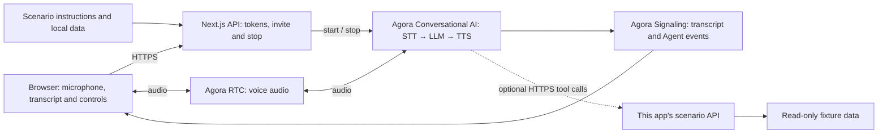

# Hotel Reception Assistant

Answer hotel questions and explain room availability for a requested stay.

[Try locally](#2-try-the-demo) · [Source on GitHub](https://github.com/littleDogWang/05-hotel-reception) · [Build with AI](#build-with-ai)

TypeScript · Web · Next.js 16 / React 19 · Agora Conversational AI

## 1. Overview

A hotel reception voice assistant for a fictional Boston hotel. Guests can ask about policies and facilities, specify a room type and dates, and discuss sample availability across a stay. The recipe includes an editable seven-night rolling inventory and a read-only room-status API.

- Hotel policy and facility answers from local, versioned data.
- King/twin clarification and exact check-in/check-out collection.
- Rolling America/New_York inventory with minimum-night availability and an explicit distinction between sold out and unknown.

**Default conversation:** Hotel FAQ, room types and dated sample counts enter the prompt at session start. They support discussion of fictional availability without calling a business tool.

**With business tools enabled:** `lookup_room_status` queries one occupied night at a time. Inline counts are omitted; a failed tool result cannot be replaced with fixed prompt inventory.

**Scope:** Availability does not create a booking. No reservation, payment, upgrade, cancellation, callback submission or human transfer is implemented. All inventory is fictional, not a live property-management feed.

## 2. Try the Demo

Run [Quick Start](#5-quick-start), open [http://localhost:3000](http://localhost:3000), allow microphone access and choose **Talk to hotel reception**. A voice session starts only after your action. The Agora project must be configured even in default conversation mode; “local data” does not mean offline speech or a local LLM.

| Try | Say | Expected behavior |
| --- | --- | --- |
| Check a stay | Do you have a standard king from today until the day after tomorrow? | The stay includes two occupied nights and excludes checkout; the shipped fixture yields a minimum of 2. |
| Change room type | What about a family suite for those same nights? | The shipped fixture has zero suites tomorrow, so that stay is unavailable. |
| Go outside the window | Can you check a room for two weeks from now? | Missing dates remain unknown; the assistant does not invent availability or call it sold out. |

Rows that describe tool actions require the optional public HTTPS tool configuration. In default mode, expect the limitations described above. These are acceptance cases to try, not a claim that a live voice run has passed. For the full scenario matrix, see [acceptance.md](docs/scenario/acceptance.md).

## 3. Architecture & Tech Stack



| Component | Role |
| --- | --- |
| Agora RTC | Carries user microphone audio and synthesized Agent speech. |
| Agora Signaling (RTM) | Delivers transcript, Agent state, metrics and error events to the browser. |
| Agora Conversational AI | Runs the managed voice pipeline and configured business tools. |
| Next.js route handlers | Keep the App Certificate server-side, issue combined RTC/RTM tokens and manage Agent sessions. |
| Scenario modules | Supply instructions, demo data and the optional business API/tool contracts. |

The client uses `agora-rtc-react`, `agora-rtc-sdk-ng`, `agora-rtm` and `agora-agent-client-toolkit`; the server uses `agora-agents`. The configured pipeline is Deepgram nova-3 → OpenAI gpt-4o-mini → MiniMax speech_2_6_turbo with English speech. See [the invite route](app/api/invite-agent/route.ts) and [runtime profile](lib/runtime-profile.ts) when changing providers. No separate vendor API key is required for the default Agora-managed configuration.

## 4. Prerequisites & Configuration

- Node.js 22 or newer and pnpm 9.15.9.
- An Agora project with its App Certificate enabled, and access to RTC, Signaling and Conversational AI.
- Access to this repository. Cloning or sharing the source requires appropriate repository permissions.
- A browser with microphone access; use HTTPS for a hosted app.

| Variable | Required? | Where / purpose |
| --- | --- | --- |
| `NEXT_PUBLIC_AGORA_APP_ID` | Required | App ID from your Agora Console project. |
| `NEXT_AGORA_APP_CERTIFICATE` | Required | App Certificate from the same project; server-side only. |
| `TOP_TEN_SCENARIO_TOOL_BASE_URL` | Optional | Public HTTPS origin of this same app, reachable by Agora cloud; enables the business tools described below. |

Create or select your project in [Agora Console](https://console.agora.io/), copy the App ID and enable/copy its App Certificate. Put them in `.env.local` using [env.local.example](env.local.example). Never prefix the certificate with `NEXT_PUBLIC_`, put it in client code or commit it.

Leave `TOP_TEN_SCENARIO_TOOL_BASE_URL` unset for the default conversation. To enable tools, deploy the same app at a reachable public HTTPS origin, set that variable on the server, restart/redeploy and start a fresh conversation. HTTP, localhost/private origins, malformed URLs and URLs with credentials, query or fragment are rejected. URL validation does not establish actual cloud reachability. In tool mode, a failed call must not be disguised as a successful fixture-based action.

## 5. Quick Start

From a terminal, clone this scenario rather than the generic starter:

```bash
git clone https://github.com/littleDogWang/05-hotel-reception.git
cd 05-hotel-reception
pnpm install --frozen-lockfile
cp env.local.example .env.local
```

Edit `.env.local` and fill the two required Agora values from section 4. Then run these commands from the cloned repository root:

```bash
pnpm run doctor
pnpm run dev
```

Alternatively, if the [Agora CLI](https://github.com/AgoraIO/cli) is already installed, bind your project with `agora login`, `agora quickstart env write . --template nextjs --project <your-project> --json` instead of manually copying credentials. Use your actual project identifier in place of `<your-project>`.

Open [http://localhost:3000](http://localhost:3000), choose **Talk to hotel reception**, allow the microphone and try the first conversation above. Check that you can hear the assistant and see both speakers in the transcript. Then verify the scenario result under the configured mode; a transcript alone does not establish that a business action occurred.

## 6. How It Works

| User step | Assistant / application behavior | Result |
| --- | --- | --- |
| Ask about policy or availability | Use hotel FAQ, or clarify room type and exact dates. | A hotel-specific answer and a defined stay. |
| Confirm the stay | Use dated prompt counts by default; in tool mode query every occupied night. | The minimum nightly count, with missing dates treated as unknown. |
| Ask to reserve or speak to staff | Explain the available next step without a booking or handoff claim. | A verbal summary of sample availability only. |

### Tools and result semantics

`lookup_room_status` calls `GET /api/scenarios/05-hotel-reception/room-status` with `room_type` and `date`. Direct API clients can instead use `check_in` and `check_out` for a 1–31-night stay. The response identifies `local_fixture` data and keeps `booking_confirmed: false`.

The invite body contains `requester_id` and `channel_name`. The supplied browser already handles this startup sequence. See [the scenario guide](docs/scenario/README.md) for additional behavior and contracts.

## 7. Customize for Your Business

| Change | Source | How |
| --- | --- | --- |
| FAQ and room types | [hotel.json](lib/hotel-reception/hotel.json) | Replace hotel policies, room IDs and the configured America/New_York setting as appropriate for your U.S. hotel. |
| Inventory validation | [hotel.ts](lib/hotel-reception/hotel.ts) | Preserve one valid room/date pair, non-negative counts and unknown-date semantics. |
| Reception behavior | [config.ts](lib/agent-config.ts) | Change the greeting and workflow; lib/agent-config.ts selects inline inventory or tool-only mode. |

For a live inventory integration, replace the room-status route's local lookup with a read from your property-management system. Preserve the room/date response contract and unknown/error handling. Add reservation creation as a separate confirmed write; do not turn an availability answer into a booking.

Shared integration points:

- [lib/agent-config.ts](lib/agent-config.ts) assembles the selected scenario prompt.
- [lib/agent-tools.ts](lib/agent-tools.ts) defines business tool schemas and server-bound routes.
- [app/api/invite-agent/route.ts](app/api/invite-agent/route.ts) selects the prompt, providers, turn detection and session settings.
- [lib/presentation.ts](lib/presentation.ts) selects the scenario presentation; edit its scenario module for visible content.
- [docs/ai/RECIPE.md](docs/ai/RECIPE.md) retains the machine-readable integration profile and lifecycle contracts.

Keep combined RTC/RTM token generation, the StrictMode initialization guard, toolkit local-user UID remapping and interrupted transcript turns intact. Let the Agora React hooks own microphone and RTC teardown. Preserve server-bound business session scope when extending tools.

### Build with AI

After cloning this repository, paste the following into your coding agent from your own application workspace, providing the path to the clone:

```text
Implement the Hotel Reception Assistant recipe in my application.

Read RECIPE.md in the cloned 05-hotel-reception repository first, then inspect
its scenario modules, tool contracts and invite route. Read docs/ai/RECIPE.md
and AGENTS.md in that repository for integration constraints.

Inspect my application's existing stack and instructions before editing.
Reuse the source's RTC/RTM token, session and transcript patterns.
Implement the scenario's default conversation first, then connect only the
business tools I request. Keep demo data and real service results distinct.
Explain the credentials and configuration I need to supply.
Ask before adding dependencies. Follow my rules for local edits, verification,
commits and remote writes. Verify the result without claiming unrun live tests.
```

This prompt is a source-guided integration entry point, not a published scaffolding package or an automatic Console import.

## 8. Deployment & Validation

### Deploy

The voice app and read-only inventory route can share a Next.js deployment. The route reads packaged hotel.json on each request. Editing inventory on a writable local server is visible to API calls without restart; changing a hosted bundle requires redeployment. Start a fresh conversation after prompt-data changes.

Install dependencies and set the same required environment variables in your deployment platform's secret store. Build with `pnpm run build` and, on a Node host, start with `pnpm run start`. Keep the public app on HTTPS. For voice tools, set `TOP_TEN_SCENARIO_TOOL_BASE_URL` to the deployed app's reachable HTTPS origin and verify cloud callbacks against that same running instance.

These commands describe the repository's supported scripts; they do not attest to an existing deployment. Before opening sample endpoints to real users, add application authentication, authorization and appropriate request limits.

### Docker deployment

```bash
docker build --build-arg NEXT_PUBLIC_AGORA_APP_ID=YOUR_AGORA_APP_ID -t 05-hotel-reception:local .
docker run --rm -p 3000:3000 --env-file .env.local 05-hotel-reception:local
```

Replace `YOUR_AGORA_APP_ID` with the public App ID used in `.env.local`. Next.js embeds that identifier in the browser bundle, so changing projects requires rebuilding the image. The App Certificate is supplied only at container runtime. A container restart does not preserve process memory. This image does not add a shared state service.

`pnpm run verify:docker` independently builds the image with synthetic credentials, starts an isolated localhost-bound container, checks the home page and a scenario route, then removes only that container. It does not contact Agora or prove a live voice session.

### Check locally

From this repository root:

```bash
pnpm run verify:template
pnpm run lint
pnpm run typecheck
pnpm run verify:api
pnpm run verify:scenario
pnpm run build
```

With the local prerequisites and credentials configured, also run `pnpm run verify`. The canonical verify script includes all of the local scenario checks above; Docker is deliberately verified separately. Local checks do not require a real microphone call and do not prove cloud tool execution.

### Verify a real conversation

1. Start a fresh voice session; check two-way audio and both transcript speakers.
2. Try the normal, correction and unsupported/failure paths in section 2.
3. Use the shipped today/tomorrow cases, a known zero and a missing date. Compare the direct stay API result with the spoken answer. Restart the server and start a new conversation after changing imported FAQ content.
4. End the call and confirm that microphone publication and the Agent session stop. Keep evidence of the actual result separately from the transcript.

### Troubleshooting

| Symptom | Check |
| --- | --- |
| Agent does not join | Check the token/invite response and run pnpm run doctor. If using the Agora CLI, run agora project doctor --deep. |
| Audio works but transcript is missing | Check RTM login/subscription and keep RtcTokenBuilder.buildTokenWithRtm in the token route. |
| Browser has no microphone | Grant permission, select an input device and use localhost or a secure HTTPS page. |
| The assistant discusses the task but does not save or change it | Check whether the optional public tool origin is enabled. The default conversation has the limits in section 1. |
| A tool fails or a result disappears | Inspect the actual API error, callback reachability and this scenario's storage/lifetime limits; do not claim success from speech alone. |

See [the contributor guide](AGENTS.md), [scenario guide](docs/scenario/README.md) and [MIT License](LICENSE) for further details.
